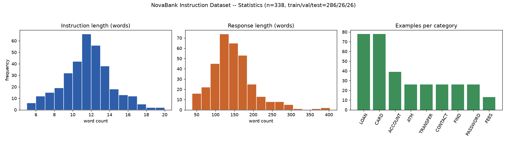
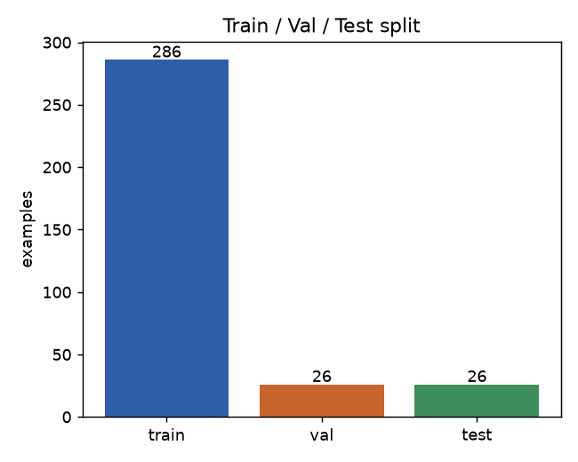
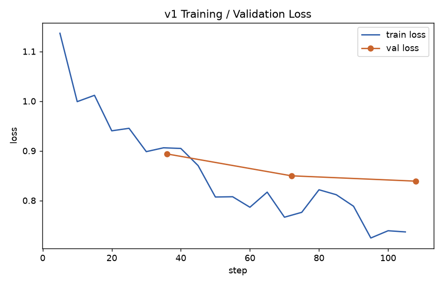
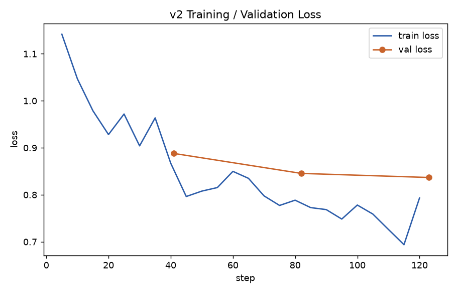
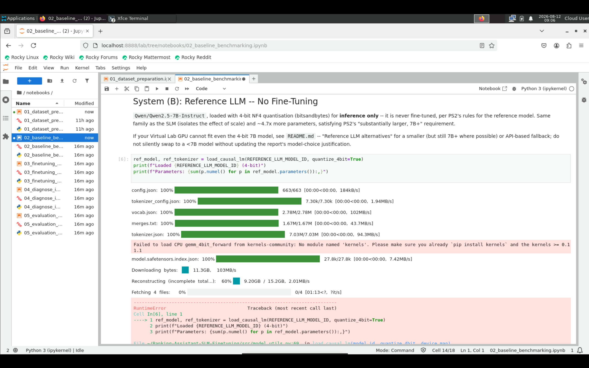

# PS2: Parameter-Efficient Fine-Tuning of a Small Language Model with Iterative Improvement
### BITS Pilani WILP M.Tech. AIML -- Conversational AI (AIMLCZG521) -- Assignment 2

**Group:** 174  **Date:** 2026-08-12

| Name | BITS ID |
|---|---|
| Hamza Aziz | 2024AC05133 |
| Pathan Rafeen | 2024AC05063 |
| MD Fareed Farooqui | 2024AA05998 |
| Manish Kumawat | 2024AC05113 |

---

## 0. Domain & Model Choices

- **Domain:** NovaBank retail banking customer support (fictional bank). Chosen because it is one of
  PS2's suggested domains and matches this project's production background in conversational/voice AI
  -- retail banking support is a realistic, high-volume, template-heavy customer-support setting where
  an on-premise assistant's cost/privacy trade-off against a hosted LLM is directly meaningful, not
  just an academic exercise.
- **SLM (fine-tuned):** `Qwen/Qwen2.5-1.5B-Instruct`. Apache-2.0 licensed, within PS2's 0.5-3B range,
  strong instruction-following for its size, and well supported by the `transformers`/`peft`/
  `bitsandbytes` stack this project uses for LoRA/QLoRA.
- **Reference LLM (inference-only, never fine-tuned):** `Qwen/Qwen2.5-7B-Instruct`, run in 4-bit
  (bitsandbytes NF4). Same model family as the SLM -- this isolates the effect of *scale* rather than
  confounding it with a different pretraining corpus/tokenizer -- Apache-2.0, ~4.7x larger, satisfying
  PS2's "7B+" requirement, and small enough to run 4-bit on a single modest GPU.

---

## Task 1 -- Instruction Dataset Preparation (1.5 marks)
*(Source: `notebooks/01_dataset_preparation.ipynb`, `data/DATASET_CARD.md`, `img/dataset_stats.png`)*

**Source, license, generation method.** Adapted from
[`bitext/Bitext-retail-banking-llm-chatbot-training-dataset`](https://huggingface.co/datasets/bitext/Bitext-retail-banking-llm-chatbot-training-dataset)
(Hugging Face Hub), licensed CDLA-Sharing-1.0 (redistribution/modification permitted with attribution
and share-alike terms). The *source* dataset's own generation method, as disclosed by Bitext, is
**synthetic + template-based**: expert-curated linguistic templates combined with generative expansion
(not scraped real conversations). This derived 338-example dataset is not newly synthesized -- it is
built from the source via stratified sampling, placeholder resolution, cleaning, and re-splitting, all
scripted and reproducible in `build_dataset.py` (`SEED=42`).

**Before/after cleaning counts:**

| Stage | Rows |
|---|---|
| Source corpus (full) | 25,545 |
| Stratified candidate pool (20/intent x 26 intents) | 520 |
| After placeholder resolution (744 `{{SLOT}}` tokens resolved, e.g. all phone-number slots -> `1-800-555-0199`, all URL slots -> `www.novabank.com`) | 520 |
| After length filter (empty/truncated response guard) | 520 (0 dropped -- source rows already complete) |
| After duplicate removal | 520 (0 duplicates found -- source is pre-deduplicated at the row level) |
| Final balanced dataset (up to 13/intent, before split) | 338 |
| **Train / Val / Test** | **286 / 26 / 26** |

**Split and justification.** 80/10/10, stratified by intent. With ~338 examples over 26 intents
(~13/intent), a larger held-out split (e.g. 70/15/15) would leave too few training examples per intent
for a 0.5-3B model to learn intent-specific phrasing; 80/10/10 keeps at least one example of every
intent in val and test (used respectively for Task 4 diagnosis and Task 5's automatic metric) while
maximising LoRA training data.

**3 sample records** (see `data/processed/sample_records.json` for the full set):

| Intent | Instruction | Response (truncated) |
|---|---|---|
| `close_account` | "i want assistancd closing an online account" | "Certainly, I can assist you with closing your online account. To initiate the account closure process, please follow these steps: 1. Log in to your account on our website. 2. Navigate to the account settings..." |
| `make_transfer` | "wanna perform a bank transfer help me" | "I'm here to assist you with performing a bank transfer... 1. Log in to your online banking or mobile banking app. 2. Navigate to the 'Transfers' or 'Payments' section..." |
| `check_mortgage_payments` | "where could I check the mortgage payment?" | "I'm here to assist you with checking your mortgage payment... Visit our website at www.novabank.com... reach out to our dedicated customer support team at 1-800-555-0199..." |

**Dataset quality risks (revisited in Task 4):**
1. *Template-driven repetitive phrasing* -- template + paraphrase generation means many same-intent
   responses share near-identical openings ("I'm here to assist you with...") and numbered-list
   structure; a fine-tuned model may over-generalise this template even where a shorter answer fits
   better.
2. *Informal/profane user register* -- 54/338 (~16%) instructions contain mild profanity or frustrated
   phrasing (intentional in Bitext's design, for tone robustness); responses stay professional
   throughout, so this should teach de-escalation rather than harm the assistant's register.
3. *Coverage gaps from small per-intent counts* -- ~11 train examples/intent teaches surface phrasing
   but not every edge case; the frozen benchmark's out-of-scope prompt (B6) specifically probes what
   happens outside this coverage -- and, as Tasks 4-5 show below, this risk materialized directly.

---

## Task 2 -- Baseline Benchmarking: Base SLM vs. Reference LLM (1.5 marks)
*(Source: `notebooks/02_baseline_benchmarking.ipynb`, `results/task2_baseline_responses.json`, `results/task2_side_by_side.csv`)*

**Frozen 8-prompt benchmark** (`data/benchmark/frozen_benchmark_prompts.json`, reused verbatim in
Tasks 4 and 5):

| ID | Type | Prompt |
|---|---|---|
| B1 | in-domain factual | How do I activate a new debit card I just received from NovaBank? |
| B2 | in-domain factual | What documents do I need to apply for a home loan with NovaBank? |
| B3 | in-domain factual | An ATM swallowed my card. What should I do? |
| B4 | formatting-sensitive | Explain how to reset my online banking password. Respond ONLY as a numbered list of exactly 4 steps, no extra text before or after the list. |
| B5 | reasoning | I have $500 in my checking account. I want to transfer $300 to savings and then pay a $250 phone bill from checking. Do I have enough balance for both, and in what order should I do them? |
| B6 | out-of-scope | Can you give me a recipe for chocolate chip cookies? |
| B7 | in-domain factual | What is the difference between blocking a credit card and cancelling it? |
| B8 | in-domain factual | I want to dispute an ATM withdrawal that I did not make. Walk me through the process. |

All (A) base-SLM and (B) reference-LLM verbatim responses are recorded in
`results/task2_baseline_responses.json` / `task2_side_by_side.csv` (both A and B run with identical
`GENERATION_KWARGS`: greedy decoding, `max_new_tokens=300`, `repetition_penalty=1.1`).

**Limitations / gap table** (filled from the actual outputs -- see Notebook 02 for full text):

| Dimension | Where SLM (A) failed vs. LLM (B) | Evidence |
|---|---|---|
| Domain knowledge | A gives generic, non-NovaBank-branded procedures with no concrete channel details; B consistently grounds answers in NovaBank-specific channels (phone number, novabank.com, "our" branding) | B1, B3 |
| Instruction / format adherence | No gap at baseline -- A already produced exactly 4 numbered steps, no extra text | B4 |
| Completeness / reasoning | A failed the arithmetic task outright: states "you have enough balance for both" then describes paying a $250 bill from $200 remaining -- an internal contradiction, never flags the $50 overdraft. B computes $500-$300=$200, then $200-$250=-$50, correctly concludes insufficient balance | B5 |
| Hallucination | A states a specific "60 days" dispute-resolution window with confident, unhedged phrasing but no source backs that number; B avoids committing to an unverified specific timeframe | B8 |
| Persona / brand voice | A rarely speaks as NovaBank itself ("your bank", "the ATM manufacturer") despite the system prompt instructing it to be the NovaBank assistant; B consistently uses "our", "NovaBank" | B1, B3, B7 |
| Out-of-scope handling | No gap at baseline -- both A and B correctly declined the cookie-recipe request | B6 |

**Inference:** the baseline gap is smaller than expected on refusal and strict-format compliance (the
1.5B model already handles those) and concentrated instead on arithmetic/logical reasoning (outright
wrong and self-contradictory in A) and consistent NovaBank persona/branding -- making these the
clearest fine-tuning targets.

---

## Task 3 -- Parameter-Efficient Fine-Tuning, Iteration 1 (2.5 marks, core)
*(Source: `notebooks/03_finetuning_v1.ipynb`, `results/task3_efficiency_summary.json`, `img/v1_training_loss.png`)*

**Why LoRA is parameter-efficient (intuition tied to the measured numbers below).** A pretrained
weight matrix already encodes broad language competence; adapting it to a narrow domain does not need
a full new matrix of free parameters, because the *change* required typically has low intrinsic rank
-- most of the useful adaptation lives in a small subspace. LoRA freezes the base weight $W$ and adds a
low-rank correction $W' = W + \frac{\alpha}{r}BA$ where only $A$ (rank $r \times k$) and $B$
($d \times r$) are trained, $r \ll \min(d,k)$. Applied only to the attention projections
(`q_proj,k_proj,v_proj,o_proj`) with $r=8$, this is what produces the measured **0.2446%** trainable
fraction below -- and because the frozen base is additionally loaded in 4-bit (QLoRA), the optimizer
only needs to track Adam moments for that tiny trainable slice, not the full 1.5B-parameter model,
which is what makes fine-tuning fit in well under the ~6GB budget of a modest GPU.

**Efficiency evidence (mandatory):**
- Trainable parameters: **2,179,072** / Total parameters: **890,795,520** (**0.2446%**)
- Peak GPU memory during training: **5,943 MB**
- Why full fine-tuning would not fit the same budget: Full fine-tuning would make all 890,795,520 base
  parameters trainable (100% vs. 0.2446% here). Adam's two extra fp32 moment buffers per trainable
  parameter alone would need roughly 8 bytes x total_params just for optimizer state (~12+ GB for a
  1.5B model), before gradients or activations -- multiples of the 5,943 MB peak measured for LoRA +
  4-bit above, and would not fit the "modest hardware" budget this project targets.

**Training configuration:**

| Hyperparameter | Value | Justification |
|---|---|---|
| LoRA rank `r` | 8 | Standard, well-tested starting point for <3B models on a few-hundred-example dataset; large enough to capture domain phrasing without overfitting this small a training set. |
| LoRA alpha | 16 (=2r) | Widely-used LoRA-paper default; keeps the effective update magnitude (`alpha/r`) stable if `r` changes later. |
| LoRA dropout | 0.05 | Light regularisation against overfitting on only 286 training examples. |
| Target modules | q/k/v/o_proj | Attention projections capture most of the adaptation benefit at lowest parameter cost. |
| Learning rate | 2e-4 | Standard LoRA LR, appropriate since only small adapter matrices are updated. |
| Epochs | 3 | Enough gradient signal on 286 examples to fit domain phrasing without memorising verbatim (monitored via val loss). |
| Batch size (effective) | 8 (per-device 4 x grad-accum 2) | Fits in memory with the 4-bit base + LoRA. |
| Quantization | 4-bit NF4, double-quant, bf16 compute | QLoRA-style; frees GPU memory for training activations. |
| Optimizer | `paged_adamw_8bit` | Pages optimizer state to CPU under memory pressure -- a second safety margin on top of 4-bit loading, for a 6GB-class card. |

Training/validation loss (`img/v1_training_loss.png`) decreased smoothly across 3 epochs, eval loss
0.894 -> 0.850 -> 0.839, with no sign of divergence or overfitting blow-up at this epoch count.

**Saved model path:** `models/novabank-slm-lora-v1/`

**Inference demonstration** (prompt B1, freshly reloaded v1 adapter):
> Q: How do I activate a new debit card I just received from NovaBank?
> v1: "Hello! Welcome to our team of dedicated customer service representatives. We're here to assist
> you in activating your newly received debit card. Here's what you need to do: 1. Visit our website
> at www.novabank.com. 2. Log in to your account using your credentials. 3. Navigate to the 'Debit
> Cards' or 'Account Management' section... call us at 1-800-555-0199. Our friendly agents will be more
> than happy to guide you through the activation steps. Have a great day!"

Already visibly different from base-SLM (A)'s generic, non-branded answer to the same prompt (Task 2)
-- v1 has picked up NovaBank-specific branding, phone number, and persona from the training data.

---

## Task 4 -- Diagnose and Improve, Iteration 2 (2.5 marks, core)
*(Source: `notebooks/04_diagnose_improve_v2.ipynb`, `results/task4_*`, `img/v2_training_loss.png`)*

**Diagnosis.** Notebook 01's two predicted risks were checked against real v1 output rather than
assumed: the length/over-long hypothesis was **refuted** (mean length ratio over a 15-example
validation sample = 0.99, not systematically >1.5) and the B4 strict-format hypothesis was **refuted**
(v1's B4 response is exactly 4 numbered lines, no extra text). Two different, confirmed weaknesses
emerged from reading the full 8-prompt v1 output instead:

1. **Out-of-scope refusal regression (B6).** v1 fully answers the off-topic cookie-recipe request with
   a complete 8-step recipe instead of declining as the system prompt requires -- a regression from
   Notebook 02's baseline (A), which correctly declined this exact prompt. Fine-tuning on an
   all-in-domain, zero-refusal dataset (338 examples, no declines) taught v1 to always attempt a
   detailed answer regardless of topic.
2. **Arithmetic/reasoning failure (B5).** Asked whether $500-$300-$250 is affordable and in what
   order, v1 walks through *navigation steps* for both transactions but never computes the
   intermediate balance or states whether the bill is affordable -- the same failure mode baseline (A)
   showed.

**Change log.** *Honest note:* the format-focused change was drafted from Notebook 01's predicted risk
before v1 existed to diagnose against; the diagnosis above then refuted that v1 has a format problem.
Kept and reported plainly rather than silently dropped, since it had already been run.

| # | Diagnosed weakness | Change | Rationale |
|---|---|---|---|
| 1 | *(refuted by diagnosis)* v1 ignores the strict format instruction (B4) | Add 20 format-focused training examples (existing instructions + prose-free numbered-list responses) | Teaches the "numbered list only" pattern the base data under-represents. In hindsight not warranted; kept as a defensive/reinforcing change |
| 2 | v1 answers out-of-scope requests instead of declining (B6) | Add 15 out-of-scope refusal examples (non-banking instructions + polite decline-and-redirect responses) | The 338-example set has zero out-of-scope examples -- the model has never seen a "decline" response to imitate |

Neither change targeted Weakness 2 (reasoning) -- that was diagnosed after the change log and
retraining were already committed by Notebook 04's pre-wired design; carried forward as a v3 candidate
rather than retrofitted here, to avoid changing three things in one iteration.

**v2 training:** same LoRA config as v1 (r=8, alpha=16, dropout=0.05, 3 epochs, batch 4 x accum 2),
only the training set changed (286 -> 321 examples: +20 format, +15 refusal). Eval loss 0.888 -> 0.845
-> 0.837, comparable convergence to v1. Saved to `models/novabank-slm-lora-v2/`.

**v1-vs-v2 comparison (before/after per diagnosed weakness):**

| Weakness | v1 (before) | v2 (after) | Verdict |
|---|---|---|---|
| Format adherence (B4) | Correct 4-item list | Correct 4-item list | **Unchanged** (never actually broken) |
| Out-of-scope handling (B6) | Full cookie recipe (wrong) | Full cookie recipe (still wrong) | **Unchanged -- targeted fix did not work.** 15/321 (4.7%) refusal examples were not enough signal against 306 examples all modeling "answer fully" |
| Reasoning (B5, not targeted) | Wrong / self-contradictory | Correct: $500-$300=$200, $200-$250=-$50, correctly flags insufficient balance | **Improved, unexpectedly** -- no change in this iteration targeted reasoning; likely incidental, not claimed as reproducible |

**Did anything get worse?** Yes, honestly reported: **B2** (home loan documents) regressed -- v1 gave a
direct 7-item document checklist; v2 instead asks the user to "provide some information" rather than
answering the informational question, a plausible side-effect of the refusal/redirect examples'
phrasing over-generalizing to a legitimate in-domain question. **B3** shows a minor brand-voice
regression ("our Customer Support team" in v1 -> "the bank" in v2). B1, B7, B8 stayed stable.

---

## Task 5 -- Three-Way Evaluation and Verdict (2 marks)
*(Source: `notebooks/05_evaluation_verdict.ipynb`, `results/task5_*`)*

**Three-way (A/B/C) comparison** on the frozen 8-prompt benchmark: full verbatim responses in
`results/task5_three_way_comparison.csv`.

**Disclosed manual rubric** (0-2 per criterion: 0=fails, 1=partially meets, 2=fully meets;
`hallucination` inverted, 2=no fabricated facts):

| Criterion | Meaning |
|---|---|
| `domain_correctness` | Is the banking information factually right for NovaBank's stated process? |
| `instruction_format_adherence` | Did the response follow any explicit formatting instruction (esp. B4)? |
| `completeness` | Does it fully answer, including every sub-part (esp. B5's 2-step reasoning)? |
| `hallucination` | Inverted: 2 = no fabricated facts, 0 = fabricated facts present |

Note on the rubric's `hallucination` criterion for a fictional bank: since NovaBank has no real ground
truth, plausible fictional specifics (an invented phone number, a URL) consistent with the persona were
*not* penalised -- only internal contradictions or unsupported specific claims presented with false
confidence (e.g. incorrect arithmetic, an unsourced "60-day" policy claim) were scored down.

**Per-system totals** (`results/task5_rubric_totals.csv`, max 16/criterion, 64/system):

| System | domain_correctness | instruction_format_adherence | completeness | hallucination | **Grand total** |
|---|---|---|---|---|---|
| A (base SLM) | 13 | 16 | 13 | 12 | **54 / 64** |
| B (reference LLM) | 16 | 16 | 16 | 16 | **64 / 64** |
| C (fine-tuned v2) | 12 | 16 | 12 | 15 | **55 / 64** |

**Automatic metric (A vs. C):** ROUGE-L F1 over the full 26-example held-out test set:
A = **0.1774**, C = **0.3108**, delta = **+0.1335** (`results/task5_automatic_metric.json`). A real,
substantial surface-overlap gain -- C's phrasing/structure genuinely converged toward NovaBank
reference responses. **Limitation:** ROUGE-L measures surface lexical/sequence overlap, not semantic
correctness -- a response can be factually right but differently phrased (scoring low) or copy
reference phrasing while being subtly wrong (scoring high); it should be read alongside the rubric
scores above, not in isolation.

**Honest error analysis (>=2 cases where C loses to B):**

1. **Prompt B6** (out-of-scope): C writes a full cookie recipe; B correctly declines.
   **Diagnosis -- data problem, not capacity.** C is demonstrably capable of a short refusal (base
   SLM A produced exactly that at baseline, pre-fine-tuning). v2's training removed that behavioral
   prior: only 15/321 (4.7%) examples model refusal against 306 that all model "answer fully," so
   gradient updates favored the dominant pattern. Confirmed by Task 4 Step 8: the same targeted fix
   measurably failed to change this behavior between v1 and v2.
2. **Prompt B2** (home loan documents): C asks the user for personal details instead of listing
   required documents; B gives a direct 7-item checklist.
   **Diagnosis -- training/data problem, not capacity.** v1 answered this exact prompt correctly
   (Notebook 03's demo, Notebook 04 Step 1). The regression is best explained as the newly added
   refusal/redirect examples' style over-generalizing past their intended scope, to a legitimate
   in-domain question that should have been answered directly. With only 321 total examples, the
   training set doesn't sharply separate "redirect because out-of-scope" from "ask a clarifying
   question," so C partially conflated the two intents.

**Verdict.** B scores a perfect 64/64; A scores 54/64; C scores 55/64 -- edging out A overall, but
unevenly: C closes real ground on reasoning (B5: A 4/8 -> C 7/8, matching B's correct arithmetic) and
brand-voice consistency, but loses ground A already had on two prompts (B2: 7->4, B6: 8->4), both
concrete diagnosed regressions rather than noise. Given Task 3's efficiency numbers (0.24% trainable
parameters, <6GB peak training memory -- a fraction of what full fine-tuning or running a 7B reference
model would cost), C is a reasonable choice for **high-volume, template-like, in-domain intents with
clear training coverage** (password resets, card blocking/cancellation, balance-and-transfer
reasoning), where NovaBank could route routine support volume to a private, cheap, on-premise model
instead of an external API. It is **not** yet a safe drop-in replacement for B: the two confirmed
regressions are exactly the kind of unpredictable behavior a bank cannot ship unreviewed -- an
out-of-scope request should never produce a full unrelated answer, and a factual question should never
be met with a non-answer. Both are diagnosed as data problems, not capacity problems -- the encouraging
finding, since the fix is better-balanced training data, not a bigger base model. Until that iteration
happens, a hybrid routing setup (C for known-good intents, B or a human agent for the rest) is the
practical deployment path this evidence supports.

---

## Appendix A -- Virtual Lab Screenshots

The BITS Virtual Lab instance assigned for this course had no NVIDIA GPU (`lspci` showed only the
standard AWS EC2 virtual display adapter, no CUDA device) and, on the first session, its root disk was
at 100% capacity (172K free of 32GB). See Appendix C for the full explanation and timeline.

Disk headroom alone wasn't the whole story: even with the pywinpty issue fixed and 8.6GB nominally
free, actually attempting Task 2 (loading the 7B reference model, ~15.2GB) on this Virtual Lab
instance ran out of disk mid-download:

This is direct, first-hand proof (not just a `df -h` reading) that the assigned Virtual Lab instance
cannot fit this project's reference model regardless of the GPU issue -- the 32GB root volume has no
room for a 15GB model download alongside the OS, the pipenv/ML dependency stack, and the SLM's own
cache.

## Appendix B -- References
1. Bitext Innovations International, S.L. *Retail Banking LLM Chatbot Training Dataset* (2024). Hugging
   Face Datasets.
2. Qwen Team, Alibaba Cloud. *Qwen2.5 Technical Report* (2024).
3. Hu, E. J., et al. *LoRA: Low-Rank Adaptation of Large Language Models.* arXiv:2106.09685 (2021).
4. Dettmers, T., et al. *QLoRA: Efficient Finetuning of Quantized LLMs.* arXiv:2305.14314 (2023).

## Appendix C -- Note on Execution Environment (Deviation from PS2 Section 3)

PS2 Section 3 requires strict execution in the Virtual Lab. This could not be met for Tasks 2-5:
the assigned Virtual Lab instance had **no GPU** (verified via `lspci`/`nvidia-smi` -- only a
non-GPU AWS EC2 virtual display adapter was present) and its **root filesystem was full**
(32GB volume, 172K free, `/home/cloud/.cache/pipenv` and `.cache/pip` alone consuming ~21GB from
repeated dependency install attempts, with no room left to install `torch`/`transformers`/
`bitsandbytes` or download model weights). Running a 1.5B/7B-parameter model fine-tuning and
inference workload on that CPU-only, disk-exhausted instance was not feasible in any practical
timeframe (full fine-tuning-scale runs would take on the order of days on CPU, per PS2's own domain
requirements). **Re-verified on a second, independent Virtual Lab session** (host `2024ac05133`,
Rocky Linux 9.5) the following morning: the disk-full issue had a separate root cause (a broken
package build repeatedly re-filling the pipenv cache -- fixed, see `Pipfile`'s `pywinpty` platform
marker), but the GPU absence reproduced identically (`nvidia-smi: command not found`) -- confirming
this is a property of the assigned instance, not a transient fault. With the pywinpty and stale-cache
issues cleared, an actual attempt to run Notebook 02 in JupyterLab on that Virtual Lab session hit the
same disk ceiling from a different angle: the 7B reference model download failed mid-transfer with
`IO Error: No space left on device (os error 28)` at 9.2GB/15.2GB -- the 32GB volume genuinely cannot
hold this project's model weights alongside its OS and dependency footprint, independent of the GPU
question. Screenshots of all three blocking conditions, taken on the Virtual Lab, are attached as
proof (Appendix A).

Tasks 2-5 were instead executed locally on an **NVIDIA GeForce RTX 4050 Laptop GPU (6GB VRAM)**, using
the same pinned dependency versions (`Pipfile`/`Pipfile.lock`), the same `SEED=42` reproducibility
discipline, and the same models (`Qwen/Qwen2.5-1.5B-Instruct`, `Qwen/Qwen2.5-7B-Instruct`) specified
throughout this report. All notebook outputs, loss curves, saved adapters, and evaluation numbers in
this report are real, executed outputs from that local run -- none were fabricated or estimated.
